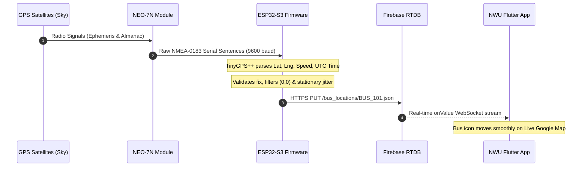

# NWU Bus Tracking — ESP32-S3 + NEO-7N GPS Hardware Guide
## ইএসপি৩২-এস৩ ও এনইও-৭এন বাস ট্র্যাকার হার্ডওয়্যার সেটআপ ও ব্যবহার নির্দেশিকা

এই ফোল্ডারে আপনার **ESP32-S3 WROOM** মাইক্রোকন্ট্রোলার এবং **u-blox NEO-7N (বা NEO-7M/NEO-6M)** জিপিএস মডিউলের জন্য সম্পূর্ণ প্রোডাকশন ফার্মওয়্যার কোড ও সার্কিট গাইড প্রস্তুত করা হয়েছে।

---

## ১. প্রয়োজনীয় যন্ত্রাংশ (Hardware Components)

| উপাদান | বিবরণ |
|---|---|
| **ESP32-S3 WROOM** | ডুয়েল-কোর ২৪০ মেগাহার্টজ, বিল্ট-ইন ২.৪ গিগাহার্টজ ওয়াইফাই ও ব্লুটুথ ৫ |
| **u-blox NEO-7N / 7M GPS** | ইউ-ব্লক্স হাই-এক্যুরেসি জিপিএস মডিউল (সিরামিক অ্যান্টেনা সহ) |
| **Jumper Wires** | ফিমেল-টু-ফিমেল বা মেল-টু-ফিমেল জাম্পার তার (৪টি) |
| **Power Supply** | ইউএসবি টাইপ-সি ক্যাবল (৫ ভোল্ট পাওয়ার ব্যাংক / বাস মোবাইল চার্জার / 12V-to-5V Buck Converter) |

---

## ২. সার্কিট কানেকশন ও পিন ডায়াগ্রাম (Wiring Diagram)

NEO-7N জিপিএস মডিউলে প্রধানত ৪টি পিন থাকে: `VCC`, `GND`, `TX`, `RX`।
ESP32-S3 বোর্ডের সাথে নিচের মতো করে কানেকশন দিন:

```
+------------------------------------+          +---------------------------+
|         u-blox NEO-7N GPS          |          |      ESP32-S3 WROOM       |
|                                    |          |                           |
|  [ VCC ] -------------------------->--------> |  3.3V (বা 5V / VIN)       |
|  [ GND ] -------------------------->--------> |  GND                      |
|  [ TX  ] -------------------------->--------> |  GPIO 18 (GPS_RX_PIN)     |
|  [ RX  ] -------------------------->--------> |  GPIO 17 (GPS_TX_PIN)     |
+------------------------------------+          +---------------------------+
```

> [!IMPORTANT]
> **TX এবং RX ক্রিস-ক্রস (Cross-over) কানেক্ট করতে হবে:**
> - জিপিএস মডিউলের **TX (Transmit)** পিন যাবে ESP32-এর **GPIO 18 (Receive)** পিনে।
> - জিপিএস মডিউলের **RX (Receive)** পিন যাবে ESP32-এর **GPIO 17 (Transmit)** পিনে।
> - জিপিএস মডিউলের পাওয়ার: অধিকাংশ NEO-7N মডিউলে বিল্ট-ইন 3.3V রেগুলেটর থাকে, তাই ESP32-এর **3.3V** অথবা **5V/VIN** পিন দুটোর যেকোনোটিতে দিলেই কাজ করবে (3.3V সবচেয়ে নিরাপদ)।

---

## ৩. সম্পূর্ণ সিস্টেম কীভাবে কাজ করে (How It Works)



1. **স্যাটেলাইট সিগন্যাল গ্রহণ**: বাসের ছাদে বা জানালার পাশে রাখা সিরামিক অ্যান্টেনা মহাকাশের জিপিএস স্যাটেলাইট থেকে সিগন্যাল গ্রহণ করে।
2. **NMEA ডাটা প্রসেসিং**: NEO-7N মডিউল প্রতি সেকেন্ডে UART সিরিয়াল পোর্টে (GPIO 18) স্ট্যান্ডার্ড NMEA ডাটা পাঠায়।
3. **ফিল্টারিং ও ভ্যালিডেশন**: ফার্মওয়্যারের `TinyGPSPlus` লাইব্রেরি অক্ষাংশ (Latitude), দ্রাঘিমাংশ (Longitude), গতিবেগ (Speed km/h) এবং স্যাটেলাইট সংখ্যা এক্সট্রাক্ট করে। যদি জিপিএস ফিক্স না থাকে বা কোঅর্ডিনেট `(0, 0)` হয়, তবে ভুল ডাটা প্রতিরোধ করে।
4. **ক্লাউড আপলোড**: প্রতি ৩ সেকেন্ড পর পর ESP32 ওয়াইফাই (ড্রাইভারের ফোনের হটস্পট বা বাসের পোর্টেবল ওয়াইফাই রাউটার) ব্যবহার করে সরাসরি **Firebase Realtime Database**-এর `/bus_locations/BUS_101.json` নোডে ডাটা আপডেট করে।
5. **অ্যাপে লাইভ মুভমেন্ট**: ইউজারের ফোনে চলা Flutter অ্যাপটি ব্যাকগ্রাউন্ডে Firebase স্ট্রিম শুনে ম্যাপে রিয়েল-টাইমে বাসের লোকেশন আপডেট করে।

---

## ৪. ফার্মওয়্যার আপলোড নির্দেশিকা (Step-by-Step Setup)

### পদ্ধতি ১: Arduino IDE ব্যবহার করে (সবচেয়ে সহজ)

#### ধাপ ১: Arduino IDE প্রস্তুত করুন
1. [Arduino IDE](https://www.arduino.cc/en/software) ওপেন করুন।
2. **File > Preferences**-এ যান। `Additional boards manager URLs`-এ নিচের লিংকটি পেস্ট করুন:
   ```
   https://raw.githubusercontent.com/espressif/arduino-esp32/gh-pages/package_esp32_index.json
   ```
3. **Tools > Board > Boards Manager**-এ গিয়ে সার্চ করুন `esp32` এবং **Espressif Systems**-এর প্যাকেজটি ইনস্টল করুন।

#### ধাপ ২: লাইব্রেরি ইনস্টল করুন
1. **Tools > Manage Libraries...** ওপেন করুন।
2. সার্চ করুন `TinyGPSPlus` (by Mikal Hart) এবং **Install** করুন।

#### ধাপ ৩: কোড ওপেন ও কনফিগারেশন
1. Arduino IDE দিয়ে [esp32_bus_tracker.ino](file:///d:/Bus%20Tracking/bus_tracking/hardware/esp32_bus_tracker/esp32_bus_tracker.ino) ওপেন করুন।
2. একই ফোল্ডারে থাকা [config.h](file:///d:/Bus%20Tracking/bus_tracking/hardware/esp32_bus_tracker/config.h) ফাইলটিতে আপনার তথ্য আপডেট করুন:
   - `WIFI_SSID`: আপনার ফোনের হটস্পটের নাম।
   - `WIFI_PASSWORD`: আপনার হটস্পটের পাসওয়ার্ড।
   - `BUS_ID`: যে বাসের জন্য এই ট্র্যাকার বানাচ্ছেন (যেমন: `"BUS_101"`, `"BUS_102"` ইত্যাদি)।

#### ধাপ ৪: বোর্ড সিলেক্ট ও আপলোড
1. আপনার ESP32-S3 বোর্ডটি টাইপ-সি ক্যাবল দিয়ে কম্পিউটারে যুক্ত করুন।
2. **Tools > Board** থেকে সিলেক্ট করুন: **ESP32S3 Dev Module** (অথবা আপনার নির্দিষ্ট S3 মডেল)।
3. **Tools > USB CDC On Boot** অপশনটি **Enabled** করুন (সিরিয়াল মনিটর দেখতে পাওয়ার জন্য)।
4. **Tools > Port** থেকে আপনার ESP32-এর COM পোর্ট সিলেক্ট করুন।
5. **Upload** বাটনে চাপ দিয়ে ফার্মওয়্যার আপলোড করুন!

---

## ৫. প্রাথমিক পরীক্ষা ও ডায়াগনস্টিক (GPS Diagnostic Tool)

সম্পূর্ণ ওয়াইফাই কোড চালানোর আগে আপনার জিপিএস মডিউলের তার ঠিকঠাক যুক্ত হয়েছে কিনা তা মাত্র ১ মিনিটে যাচাই করতে পারবেন:

1. [gps_diagnostic.ino](file:///d:/Bus%20Tracking/bus_tracking/hardware/esp32_bus_tracker/gps_diagnostic.ino) ফাইলটি Arduino IDE-তে ওপেন করে ESP32-তে আপলোড করুন।
2. **Tools > Serial Monitor** ওপেন করুন এবং Baud Rate সেট করুন `115200`।
3. **ফলাফল যাচাই**:
   - `Characters Processed` সংখ্যা বাড়ছে: মানে তার ও পিন কানেকশন ১০০% ঠিক আছে!
   - `Characters Processed: 0`: মানে TX এবং RX তার উল্টো লাগানো হয়েছে। তার দুটি অদলবদল করুন।
   - অ্যান্টেনাটি জানালার পাশে বা বাইরে ধরলে ১-২ মিনিটের মধ্যে `[*] GPS FIX ACQUIRED!` দেখাবে এবং লাইভ Latitude ও Longitude প্রিন্ট হতে থাকবে।

---

## ৬. বাসে ইনস্টলেশন ও পাওয়ার সরবরাহ (Bus Installation)

- **পাওয়ার সোর্স**: বাসের ড্যাশবোর্ডে থাকা যেকোনো ৫ ভোল্ট ইউএসবি মোবাইল চার্জার অথবা বাসের ১২V/২৪V ব্যাটারি থেকে একটি **12V-to-5V 3A Buck Converter** ব্যবহার করে ESP32-এর USB বা 5V/GND পিনে পাওয়ার দেওয়া যাবে।
- **অ্যান্টেনা পজিশন**: NEO-7N জিপিএস অ্যান্টেনাটির চৌকো মেটালিক দিকটি সব সময় আকাশের দিকে মুখ করে বাসের সামনের উইন্ডশিল্ড (Front Windshield) বা জানালার কাছে স্থাপন করতে হবে। ধাতব টিনের নিচে সরাসরি অ্যান্টেনা ঢাকা থাকলে স্যাটেলাইট সিগন্যাল কিছুটা বাধাগ্রস্ত হতে পারে।
- **ইন্টারনেট সংযোগ**: ড্রাইভার বা কন্ডাক্টরের ফোনের পোর্টেবল হটস্পট চালু রাখলে বাস অন হওয়ার সাথে সাথে ESP32 নিজে থেকেই হটস্পটে কানেক্ট হয়ে স্বয়ংক্রিয় ট্র্যাকিং শুরু করবে।
